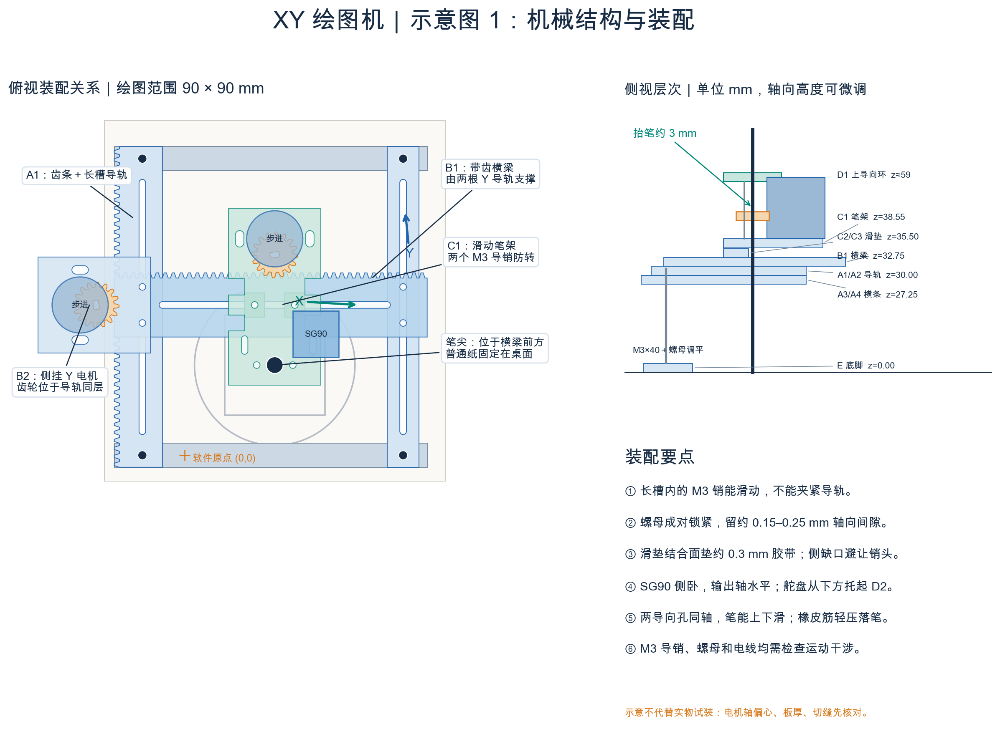
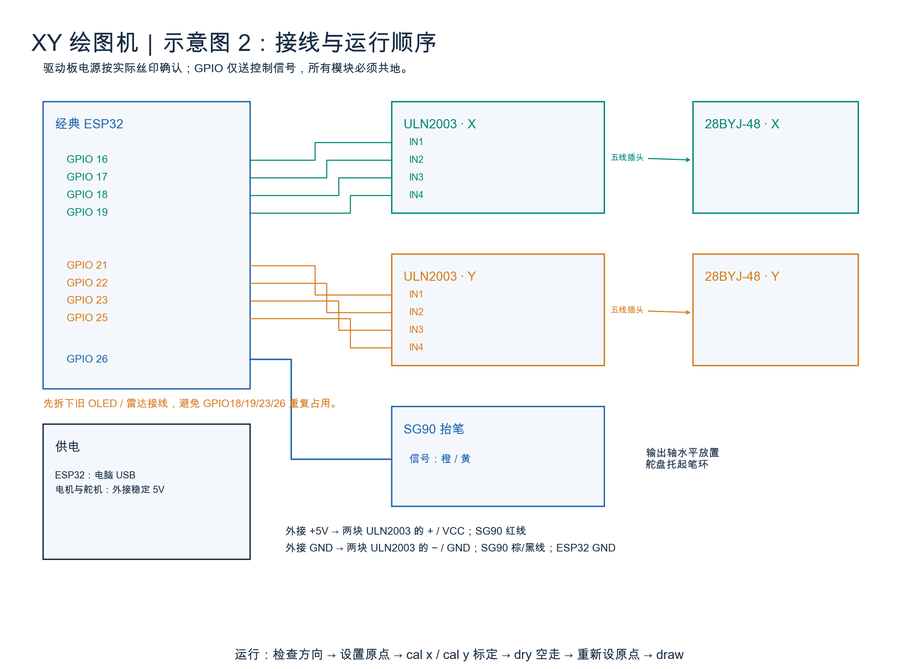

# 天圆地方：ESP32 XY 绘图机

用两个步进电机控制笔尖的左右、前后位置，用一个舵机抬笔和落笔，在普通纸上画出同心的圆和正方形。

默认图形：直径 **80 mm** 的圆、边长 **50 mm** 的正方形；工作范围为 **90 × 90 mm**。机械主体使用亚克力，配M3螺杆螺母、胶带和少量热熔胶。

## 先看运动演示

可播放的演示网页是 **[index.html](index.html)**。把仓库下载到电脑后，用Safari或Chrome打开它，点击图下方的 **“播放一遍”**，也能拖动进度条看各个动作。

GitHub文件预览会显示HTML源码；网页需要在浏览器里打开。通过仓库的 **Code → Download ZIP** 下载并解压后，双击根目录的 `index.html` 即可播放。

演示保留了可编辑的源文件和独立播放版本：

- [运动演示源文件](XY绘图机/示意图/xy-motion.html)
- [独立播放版本](XY绘图机/示意图/xy-motion-play.html)

演示是加速的简化运动模型，用来理解横梁、笔架和抬笔的配合。

## 文件入口

| 内容 | 位置 |
|---|---|
| 完整使用说明 | [README_先看这里.md](XY绘图机/README_先看这里.md) |
| 装配、接线、原点与尺寸标定 | [装配与调试.md](XY绘图机/装配与调试.md) |
| 正式切割DXF | [01_提交切割_195x195_Layer0.dxf](XY绘图机/图纸/01_提交切割_195x195_Layer0.dxf) |
| 零件编号排版 | [02_编号排版.png](XY绘图机/图纸/02_编号排版.png) |
| 零件尺寸与孔位 | [尺寸图](XY绘图机/图纸/03_零件尺寸图.svg)、[孔位CSV](XY绘图机/图纸/零件孔位.csv) |
| ESP32程序 | [代码目录](XY绘图机/代码) |
| 图纸生成源程序 | [生成图纸.py](XY绘图机/生成图纸.py) |
| 软件功能检查 | [检查程序.py](XY绘图机/验证/检查程序.py) |
| 作业要求 | [要求.md](要求.md)、[正式要求截图](微信图片_20261104220640_549_7188.png) |
| 老师提供的齿轮齿条参考 | [Gear+Bar.dxf](Gear+Bar.dxf) |

## 机械结构与接线





## 程序怎么运行

硬件按经典ESP32、两套5V 28BYJ-48/ULN2003和一个SG90设计。先按装配说明核对实际型号与尺寸。

1. 用Thonny把 `XY绘图机/代码/` 下的四个Python文件保存到ESP32根目录，运行 `main.py`。
2. 调整舵机抬笔/落笔脉宽，检查 `jog x 5`、`jog y 5` 的运动方向。
3. 定位原点后输入 `zero YES`，用 `cal x`、`cal y` 分别标定50 mm行程。
4. 先 `dry` 全程抬笔空走；重新确认原点后，`zero YES`、`draw` 正式绘制。

电机与舵机使用稳定外接5V，ESP32由USB供电，所有模块共地。详细接线和调试步骤见装配说明。

## 电脑端生成与检查

需要Python 3。以下依赖版本是本次本地实际使用的版本：

```bash
python3 -m pip install -r requirements.txt
python3 XY绘图机/生成图纸.py
python3 XY绘图机/验证/检查程序.py
```

代码文件属于MicroPython程序；上述功能检查在电脑上模拟GPIO与时间，无需连接ESP32。

当前检查结果：

- 19件零件排入195 × 195 mm范围，最小零件间距2.5 mm；正式DXF仅含Layer 0，切割轮廓闭合。
- 10项程序模拟检查通过，涵盖双轴插补、图形闭合、软限位、空走、超时与中断处理。
- 默认流程的名义模拟时间约285秒；这不包含实物卡顿与全部控制开销。

**当前为尚未实物试装的原型。** 切割前需用试切片确认轴孔和槽宽，并实测笔径、电机尺寸及板厚；装配后还需完成方向、尺寸、笔压与全行程干涉检查。完整检查结果见 [图纸检查报告](XY绘图机/图纸/图纸检查报告.json) 和 [程序检查报告](XY绘图机/验证/程序检查报告.json)。
